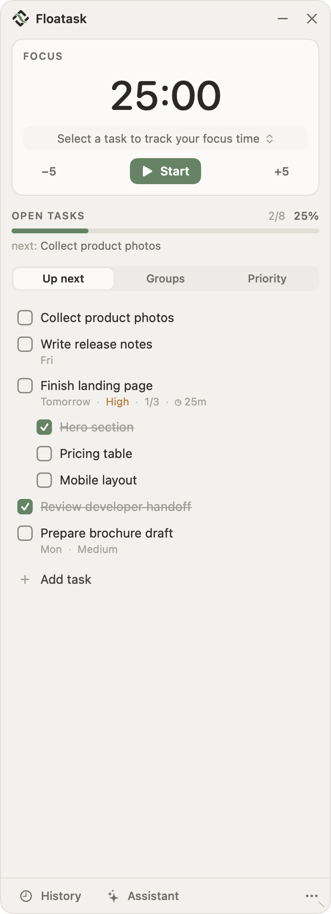
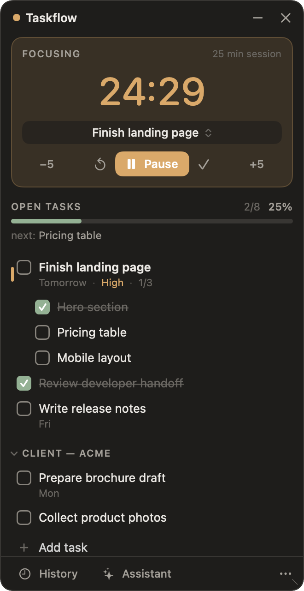

<p align="center">
  
</p>

<h1 align="center">Floatask</h1>

<p align="center">
  A small, calm, always-on-top task panel for macOS. It saves everything as plain Markdown in your Obsidian vault.<br>
  Checklists · focus timer · time tracking · history · private on-device AI assistant
</p>

<p align="center">
  <a href="https://github.com/shihab-abir/Floatask/actions/workflows/ci.yml"></a>
  <a href="https://github.com/shihab-abir/Floatask/releases/latest"></a>
  
  <a href="LICENSE"></a>
</p>

<p align="center">
  
  &nbsp;&nbsp;
  
</p>

Floatask floats above your other apps (Figma, your browser, your editor), so your tasks and focus
timer stay in view while you work. Collapse it to a tiny pill that shows the countdown. There's no
account and no cloud; your data lives in your own vault.

<p align="center"></p>

## Features

- **Checklist with subtasks.** Add a task with Enter. Nest steps under it. A progress bar shows how
  much is done.
- **Focus timer.** Pomodoro-style, adjustable in 5-minute steps, linked to the task you're working on.
- **Time tracking and history.** Focus time per task, today and this week, plus completed tasks by day.
- **Obsidian-native.** Tasks are normal `- [ ]` checkboxes in `Task Manager/Tasks.md`. Tick one in
  Obsidian and the panel updates instantly, and the reverse.
- **Crash-proof.** The timer is stored as timestamps, so quitting, crashing or restarting never loses
  a session.
- **Private AI assistant (optional).** "Remind me to send the invoice on Friday", "break this task
  into steps", "how did I spend my time today?" It runs on Apple Intelligence's on-device model by
  default. You can add a Claude API key if you prefer.
- **Terminal command.** `floatask add`, `floatask done 3`, `floatask focus 1`, and more.
- **Calm by design.** Muted colours, one accent, light and dark mode, full keyboard control.

## Install

**Requirements:** macOS 26 or newer on a Mac with Apple silicon (M1 or later).

Open **Terminal** and paste:

```bash
curl -fsSL https://raw.githubusercontent.com/shihab-abir/Floatask/main/install.sh | bash
```

That's it. The script:
1. downloads the latest release,
2. checks it against its published checksum,
3. puts `Floatask.app` in `~/Applications`,
4. adds the `floatask` command,
5. opens the app.

On first launch, pick your Obsidian vault. Any folder works if you don't use Obsidian.

<details>
<summary><b>Manual install (without Terminal)</b></summary>

1. Download `Floatask-x.y.z-macos-arm64.zip` from the
   [latest release](https://github.com/shihab-abir/Floatask/releases/latest) and unzip it.
2. Drag **Floatask.app** into your **Applications** folder.
3. Floatask isn't notarized by Apple yet, so the first time you open it macOS will block it. Go to
   **System Settings → Privacy & Security**, scroll down and click **Open Anyway**. You only need to
   do this once.

The `floatask` terminal command is optional. To add it:
`mkdir -p ~/.local/bin && ln -sf /Applications/Floatask.app/Contents/MacOS/floatask-cli ~/.local/bin/floatask`
</details>

<details>
<summary><b>Build from source</b></summary>

You need Apple's Command Line Tools (`xcode-select --install`). Full Xcode isn't required.

```bash
git clone https://github.com/shihab-abir/Floatask.git
cd Floatask
./install.sh --from-source
```
</details>

**Update:** run the install command again. **Uninstall** (your tasks are kept):

```bash
curl -fsSL https://raw.githubusercontent.com/shihab-abir/Floatask/main/uninstall.sh | bash
```

## Using Floatask

| To… | Do this |
|---|---|
| Open the panel | `floatask` in Terminal, or open Floatask from Applications |
| Collapse to the floating pill | click **–** (or `⌘M`) |
| Bring it back | click the pill |
| Quit | click **×**, or `floatask quit` |
| Move | drag the panel's title bar, or drag the pill anywhere |
| Resize | drag the panel's bottom-right corner |
| Edit a task | double-click it. Right-click for priority, due date, group, delete |
| Track focus | pick a task under the timer, press **Start** |

Closing the app never loses a running timer. It carries on when you reopen.

### Keyboard shortcuts

| Keys | Action | Keys | Action |
|---|---|---|---|
| `⌘N` | Add task | `⌘↩` | Start / pause timer |
| `↑` `↓` | Move through tasks | `⌘⇧F` | Choose focus task |
| `Space` | Check / uncheck | `⌘K` | Assistant |
| `↩` or `F` | Make it the focus task | `⌘Y` | History |
| `E` | Edit task | `⌘M` | Collapse |
| `Esc` | Back / return to your previous app | | |

### Terminal

```text
floatask                          open the panel
floatask list                     show open tasks, numbered
floatask add "Call printer" --due tomorrow --priority high
floatask add "Hero section" --under 1        add a subtask to task 1
floatask done 3                   complete task 3   (floatask undo 3 reopens it)
floatask focus 1 25               25-minute focus session on task 1
floatask pause | resume | stop
floatask status | history
floatask ask "Break task 1 into steps"
floatask config "/path/to/vault"  choose the vault
floatask help
```

## Your data

Everything is plain Markdown in a `Task Manager` folder inside your vault:

```text
Task Manager/
├── Tasks.md        your checklist (edit it in Obsidian too)
├── Sessions.md     focus history
├── Settings.md     preferences
└── Archive/        completed tasks, by month
```

```markdown
- [ ] Finish landing page · due 2026-10-02 · high #design <!-- id:t_20260929_ab12 -->
	- [x] Hero section <!-- id:t_20260929_ef56 done:2026-09-29T11:00:00+06:00 -->
```

Completed tasks stay visible (greyed out) for the rest of the day, then move to the monthly archive.
They remain under **History → Completed**. Every change is written atomically, with a rolling
backup in `Task Manager/.backups/`. The full format is in [docs/FORMAT.md](docs/FORMAT.md).

## AI assistant and privacy

- **Default: on this Mac.** It uses Apple Intelligence's built-in model. Nothing leaves your
  computer, and there's nothing extra to download. Apple Intelligence must be turned on in
  System Settings.
- **Optional: Claude.** Paste an Anthropic API key in **Settings → Assistant**. The key is stored in
  the macOS Keychain, never in your vault. The panel always says whether a request is sent to an
  external service.
- **The assistant can only propose changes.** It picks from a fixed set of task operations, and you
  review them before anything is saved. Deletes start unticked. It can't run commands or touch
  other files.

There's no telemetry and no account.

## Troubleshooting

- **"floatask: command not found".** Open a new Terminal window. The installer added
  `~/.local/bin` to your PATH.
- **macOS says the app "can't be opened".** Use **System Settings → Privacy & Security → Open
  Anyway**. Or install with the Terminal command above, which avoids this.
- **The assistant says it's unavailable.** Turn on Apple Intelligence in **System Settings → Apple
  Intelligence & Siri**, or add a Claude API key in Floatask's Settings.
- **Something looks wrong with your tasks.** Check `~/Library/Logs/Floatask.log`. Backups of your
  files are in `Task Manager/.backups/` in your vault.

Found a bug or have an idea? [Open an issue](https://github.com/shihab-abir/Floatask/issues).

## Contributing

See [CONTRIBUTING.md](CONTRIBUTING.md) for the project layout, how to build and test, and how
releases are made.

## License

[MIT](LICENSE) © Shihab Abir
